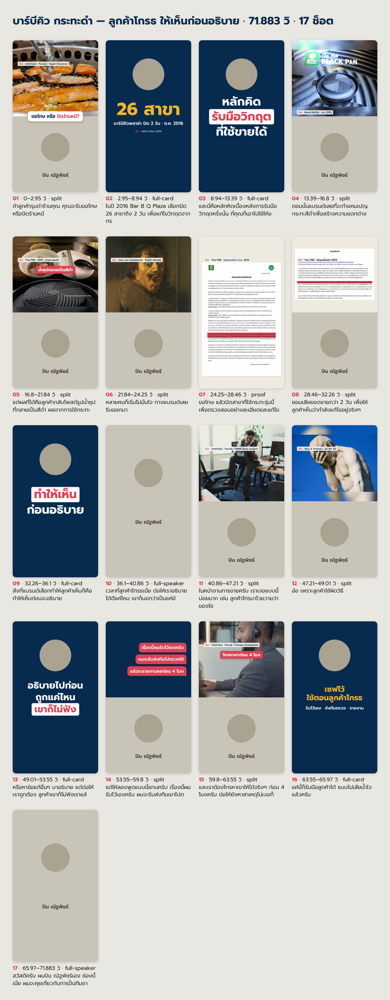

[← กลับหน้าแรก (README)](../README.md)

# ตัดคลิปแรก

หน้านี้เดินตามคลิปจริงหนึ่งคลิป: คลิปดิบ 107 วินาที ถ่ายด้วยมือถือ เล่าเรื่องร้านปิ้งย่างที่ปิด 26 สาขา 2 วันในปี 2016
เลือกทำครบทุกขั้นแบบรวดเดียว บน Mac ชิป M4 ใช้ 30 นาทีโดยไม่มีใครแตะเครื่อง ได้คลิป 72 วินาที ตัดทิ้ง 19 ท่อน

## ก่อนเริ่ม

kit นี้ทำคลิปแนวตั้งสำหรับ TikTok, Reels และ Shorts ถ่ายแนวตั้ง 9:16 มาตั้งแต่แรก
คลิปจาก iPhone ที่เป็น HDR หรือเฟรมเรตไม่คงที่ใช้ได้ ระบบแปลงสีกับเฟรมเรตให้ตอนตัด

พูดผิดก็พูดประโยคนั้นใหม่ได้เลย ไม่ต้องหยุดกล้อง Claude เก็บเทคสุดท้ายที่พูดครบ
หยุดหายใจสั้นๆ ก่อนเริ่มเทคใหม่ช่วยให้แยกเทคได้แม่นขึ้น เพราะระบบหาขอบของแต่ละวลีจากช่วงเงียบ
คำอย่าง "เอาใหม่" หรือการนับ 1-2-3 ก่อนพูดถูกตัดทิ้งให้เอง

เช็คพื้นที่ว่างบนไดรฟ์ที่เก็บคลิป ควรมีอย่างน้อย 3 เท่าของขนาดไฟล์บวก 5 GB
คลิปตัวอย่างไฟล์ 337 MB จึงต้องมีที่ว่างราว 6 GB เพราะไฟล์กลางทางเก็บความละเอียดเดิมไว้ ไฟล์ `roughcut.mp4` ของคลิปนี้ใหญ่ 303 MB

## เริ่ม

ลากไฟล์วิดีโอเข้าไปในช่องแชท แล้วพิมพ์ `ตัดคลิป`

ถ้าแอปไม่รับไฟล์ที่ลากเข้าไป ก๊อป path ของไฟล์มาวางต่อท้ายคำว่า ตัดคลิป แทน
Mac: คลิกไฟล์ใน Finder แล้วกด Option+Cmd+C · Windows: คลิกขวาที่ไฟล์ → Copy as path (Windows 10 ต้องกด Shift ค้างตอนคลิกขวา)
ชื่อไฟล์ภาษาไทยหรือมีเว้นวรรคใช้ได้

Claude ตรวจเครื่องสั้นๆ อ่านข้อมูลคลิป (ยาวเท่าไหร่ ความละเอียด เฟรมเรต พื้นที่ว่าง) แล้วบอกเวลาโดยประมาณ
บน Mac ชิป M ราว 15–20 นาทีต่อคลิปดิบ 1 นาทีถ้าทำครบ บน Windows ที่ไม่มีการ์ดจอ NVIDIA ขั้นถอดเสียงนานกว่านั้นหลายเท่า

## คำถามตอนเริ่ม

Claude ถามครั้งเดียวก่อนลงมือ ไม่เกิน 2 รอบ

รอบที่ 1

| คำถาม | ตัวเลือก | คลิปแรกแนะนำ |
|---|---|---|
| คลิปนี้ | ตัดเทคมาเองแล้ว (ทำต่อจากซับ) · ให้ Claude ตัดเทคซ้ำกับช่วงเงียบให้ | ให้ Claude ตัด ถ้ายังไม่ได้ตัดเอง |
| ให้ทำแค่ไหน | ครบ: ตัด + ซับ + ภาพประกอบ · ตัด + ซับ · แค่ซับ | "ตัด + ซับ" ถ้าอยากลองเร็วๆ · "ครบ" ถ้ามีเวลาครึ่งชั่วโมง |
| ระหว่างทำ | ถามผมก่อนตัดสินใจสำคัญ · ทำรวดเดียวจนจบ ไม่ต้องถาม | "ถามก่อน" คลิปแรกจะได้เห็นว่า Claude ตัดสินใจยังไง |

รอบที่ 2 มีเฉพาะเมื่อเลือก "ครบ"

| คำถาม | ตัวเลือก |
|---|---|
| ใส่อะไรบ้าง (เลือกได้หลายข้อ) | ภาพจริง/หลักฐาน · คลิปจริง · มีม · เสียงเอฟเฟกต์ |
| เอามาจากไหน | ให้ Claude หาจากเน็ตให้ · ผมมีไฟล์เอง (บอกโฟลเดอร์) · ผสมกัน |
| แบบภาพประกอบ | cutaway: ตัดไปภาพแล้วกลับมาที่คุณ (แนะนำ) · stage: คุณยืนบนเวที ฉากหลังเปลี่ยนทุก 1–2 วิ — ดู [2 แบบภาพประกอบ](09-modes.md) |

การ์ดข้อความกับกราฟิกใส่ให้เสมอ ไม่อยู่ในตัวเลือก
ความละเอียดไฟล์มาจากค่าที่ตั้งตอนติดตั้ง (ค่าเริ่มต้น 1080p) เรื่องมีมกับแหล่งของภาพอ่านต่อได้ที่ [แทรกภาพ คลิป มีม เสียง](04-insert-materials.md)

โหมด "ถามก่อน" Claude จะหยุดให้คุณดู 3 จุด: รายการท่อนที่ตัดทิ้ง · รายการภาพที่จะโหลดพร้อมไลเซนส์ · storyboard ก่อนเรนเดอร์
โหมด "ทำรวดเดียว" Claude ตัดสินเองทั้งหมด แล้วสรุปทุกการตัดสินใจไว้ในข้อความส่งงานให้คุณสั่งแก้ทีหลัง
ถ้าจะทำรวดเดียวแล้วเดินไปทำอย่างอื่น ตั้งโหมดสิทธิ์ของแท็บ Code เป็น Auto ก่อน ไม่งั้นงานจะค้างรอคุณกดอนุญาตคำสั่งถัดไป

## ระหว่างทำ Claude ทำอะไรบ้าง

เวลาในตารางวัดจากคลิปตัวอย่างบน Mac ชิป M4
รอบนั้นเรนเดอร์ที่ 60 fps ตามคลิปดิบ ค่า 1080p รุ่นปัจจุบันจำกัดไว้ที่ 30 fps ขั้นเรนเดอร์จึงเร็วกว่าตัวเลขในตาราง

| ขั้น | Claude ทำอะไร | เวลาจริง |
|---|---|---|
| ถอดเสียงทีละวลี | แบ่งคลิปตามช่วงเงียบได้ 57 วลี แล้วฟังทีละวลี | 1.5 นาที |
| เลือกเทคแล้วตัด | ตัด 19 ท่อน ได้ `roughcut.mp4` ยาว 71.8 วินาที กับรายงาน `roughcut-review.md` | 2 นาที |
| ซับคาราโอเกะ | ถอดเสียงทั้งคลิปอีกรอบเพื่อจับเวลาทีละคำ แก้คำที่ฟังผิด | 5.5 นาที |
| ตรวจข้อเท็จจริง + หาภาพจริง | ทำคู่ไปกับ 2 ขั้นบน | 4 และ 6.5 นาที |
| วางแผนภาพ + storyboard | เลือกว่าแต่ละช่วงโชว์อะไร แล้ววาดการ์ดกับภาพรวมทุกช็อต | 5 นาที |
| เรนเดอร์ | ทำการ์ดให้ขยับ ประกอบลงคลิป ฝังซับ คุมเสียงไม่ให้พีค | 7 นาที |
| ตรวจงาน + แก้ | ตัวตรวจไฟล์ แล้ว Claude เปิดดูเฟรมเอง เจอป้ายที่มาบังหัวเอกสาร ย้ายแล้วเรนเดอร์ใหม่ | 6 นาที |

ในคลิปนี้ ตัวถอดเสียงทำซับหายไป 14 วินาทีกลางคลิป รายงานซับขึ้นธงว่าช่วงนั้นยังมีเสียงพูด Claude จึงถอดเฉพาะช่วงนั้นใหม่จนซับครบ

storyboard หน้าตาแบบนี้ โหมดถามก่อน Claude จะส่งให้ดูก่อนเรนเดอร์ แก้แผนตอนนี้เสียเวลาน้อยที่สุด

## ได้อะไรกลับมา

ทุกไฟล์อยู่ในโฟลเดอร์ `tad-clip-<ชื่อคลิป>` ข้างไฟล์คลิปของคุณ ไฟล์ต้นฉบับไม่ถูกแตะ

| ไฟล์ | คืออะไร |
|---|---|
| `final.mp4` | คลิปพร้อมลง คลิปตัวอย่างได้ 71.9 วินาที 1080×1920 |
| `roughcut-review.md` | ทุกวลีในคลิปดิบ บอกว่าเก็บหรือทิ้ง เพราะอะไร |
| `CREDITS.md` | ทุกภาพ คลิป มีม เสียงที่แทรก มาจากไหน ไลเซนส์อะไร ใช้ยิงแอดได้ไหม + ตารางตรวจข้อเท็จจริง |
| `out/edit-sheet.md` | ตารางบอกทุกช็อต ไฟล์ไหน วางแทร็กไหน สำหรับคนที่อยากแต่งต่อใน CapCut |
| `out/preview-composite-720p.mp4` | ไฟล์เล็กไว้ส่งเข้ามือถือดู (มีเมื่อทำแบบมีภาพประกอบ) |
| `out/storyboard.png` | ภาพรวมทุกช็อต |
| `subs/` | ไฟล์ซับ `.srt` `.ass` `.lrc` เอาไปใช้กับแอปตัดต่ออื่นได้ |
| `roughcut.mp4` | คลิปที่ตัดเทคแล้วก่อนใส่ซับ ไฟล์ใหญ่ เก็บไว้จนกว่าจะพอใจคลิปสุดท้าย |
| `meme-candidates.md` | มีเฉพาะโหมดรวดเดียวที่ขอมีมแต่ยังไม่มีคลังมีม ดู [หน้า 04](04-insert-materials.md) |

ในแชท Claude ส่งข้อความสรุป: path ของ `final.mp4` · ตัดอะไรออกไป · ภาพที่แทรกมาจากไหนและชิ้นไหนห้ามเอาไปยิงแอด · ทุกการตัดสินใจที่ทำแทนคุณ (โหมดรวดเดียว) · caption แนะนำ 1 ชุด (ประโยคเปิด สาระ 3 บรรทัด และคำชวนคอมเมนต์) · วิธีสั่งแก้

### roughcut-review.md อ่านยังไง

บรรทัดบนสุดของคลิปตัวอย่าง:

> ตัด 19 ท่อน จาก 57 วลี · roughcut.mp4 = 71.82 วินาที จากเดิม 107.6 วินาที

ตัวอย่าง 4 แถวจากตาราง

| เลขวลี | เวลา (วิ) | ข้อความ (whisper) | เก็บ/ทิ้ง | เหตุผล |
|---|---|---|---|---|
| 0 | 0.96-1.93 | ถ้าลูกค้ารุมด่าแล้ว | ทิ้ง | เริ่มพูด 'ถ้าลูกค้ารุมด่าแล้ว' แล้วหยุด (false start) — วลี 1 เป็นประโยคเต็ม |
| 1 | 2.51-5.28 | ถ้าลูกค้าลุมด่าร้านคุณ คุณจะรีบขอโทษหรือปิดร้านหนี | เก็บ |  |
| 13 | 28.76-28.89 | บ้าจริง | ทิ้ง | 'บ้าจริง' 0.13 วิ เสียงบ่นตัวเองหลังพูดพลาด |
| 32 | 63.41-63.55 | โปรดติดตามตอนต่อไป | ทิ้ง | 0.14 วิ whisper แต่ง 'โปรดติดตามตอนต่อไป' = เสียงรบกวน |

ช่องข้อความเป็นสิ่งที่ตัวถอดเสียงได้ยินแบบดิบ คำว่า "ลุมด่า" ในวลี 1 ยังสะกดผิด ส่วนซับในคลิปจริงผ่านการตรวจคำอีกรอบแล้ว
วลี 32 ยาวแค่ 0.14 วินาที ตัวถอดเสียงแต่งข้อความขึ้นมาเองจากเสียงรบกวน วลีสั้นกว่า 0.2 วินาทีที่ได้ข้อความแบบนี้ถูกทิ้งทุกครั้ง
บางจุด Claude ต้องเลือกระหว่างสองเทคที่พูดครบทั้งคู่ ในคลิปนี้คือวลี 22 กับ 23–25 Claude เก็บเทคหลังตามกติกา และเขียนในช่องเหตุผลว่าถ้าอยากได้เทคแรก ให้สั่ง "เอาท่อน 22 กลับมา"

### CREDITS.md กับการตรวจข้อเท็จจริง

คลิปตัวอย่างจดของที่หามาได้ 13 ชิ้น ติดธง "ใช้ยิงแอดได้: ไม่" 5 ชิ้น คือภาพและเอกสารจากหน้าข่าว 4 ชิ้น กับภาพไลเซนส์ CC BY-SA 1 ชิ้น
ตารางตรวจข้อเท็จจริงไล่ 8 เรื่องที่พูดในคลิป ถูก 3 ข้อ ถูกบางส่วน 4 ข้อ อีก 1 ข้อเป็นความเห็นของผู้พูดเอง
ซับยังเก็บคำพูดจริงไว้ แต่ตัวเลขที่หาแหล่งยืนยันไม่ได้จะไม่ขึ้นจอ ก่อนโพสต์ควรอ่านตารางนี้ เพราะบางข้ออาจอยากอัดใหม่
กติกาเรื่องยิงแอดเต็มๆ อยู่ที่ [ลิขสิทธิ์ของที่แทรก](07-copyright.md)

## สั่งแก้ด้วยภาษาธรรมดา

พิมพ์บอก Claude เหมือนบอกคนตัดต่อ Claude แก้เฉพาะขั้นที่เกี่ยว แล้วตรวจงานใหม่ทุกครั้ง

| อยากได้ | พิมพ์ประมาณนี้ |
|---|---|
| เอาท่อนที่ตัดทิ้งกลับมา | `เอาท่อน 22 กลับมา` (เลขจาก `roughcut-review.md`) |
| ตัดเพิ่ม | `ตัดท่อน 31 ออกด้วย` |
| จังหวะเร็วไปจนฟังเหนื่อย | `เว้นช่วงหายใจระหว่างประโยคให้ยาวขึ้นหน่อย` |
| จังหวะช้าไป | `ตัดช่วงเงียบให้กระชับกว่านี้` |
| ซับสะกดผิด | `ซับคำว่า ยอก ผิด ที่ถูกคือ ยอด` |
| ซับตัดบรรทัดกลางคำ | `ซับบรรทัดที่มีคำว่า ยอมเสีย ตัดกลางคำ` |
| เปลี่ยนภาพ | `ภาพตรงวินาทีที่ 12 เปลี่ยนเป็นรูปหน้าร้าน` |
| เสียงเอฟเฟกต์ดังไป | `เสียงเอฟเฟกต์เบาลงอีก` |
| ให้จำคำนี้ทุกคลิป | `จำไว้ว่า ช้อปปี้ ต้องเขียนว่า Shopee` |
| ซับใหญ่ขึ้น สีแบรนด์ ความละเอียด | ดู [สี ฟอนต์ ตำแหน่งซับ](05-brand-style.md) |

แก้ภาพช็อตเดียวใช้เวลาราว 2 นาที เพราะทำการ์ดใหม่แค่ช็อตนั้นแล้วประกอบทั้งคลิปใหม่
แก้เรื่องท่อนที่ตัด ควรบอกตอน Claude ส่งรายการท่อนที่ทิ้งให้ดู ถ้าบอกหลังเรนเดอร์ ซับกับภาพต้องทำใหม่ตามเวลาใหม่ทั้งหมด

สั่ง `ตัดคลิป` ซ้ำกับคลิปเดิมได้ ขั้นที่ทำเสร็จแล้วจะข้าม และ Claude จะไม่เขียนทับไฟล์ที่คุณหรือ Claude แก้ไว้ (`drops.json` `edits.json` `plan.json` `sfx.json`) โดยไม่ถามก่อน

kit ไม่ใส่เพลงประกอบให้ ถ้าจะใส่เพลง ใส่จากคลังเพลงของแอปตอนโพสต์

---

ถัดไป: [แทรกภาพ คลิป มีม เสียง →](04-insert-materials.md)
