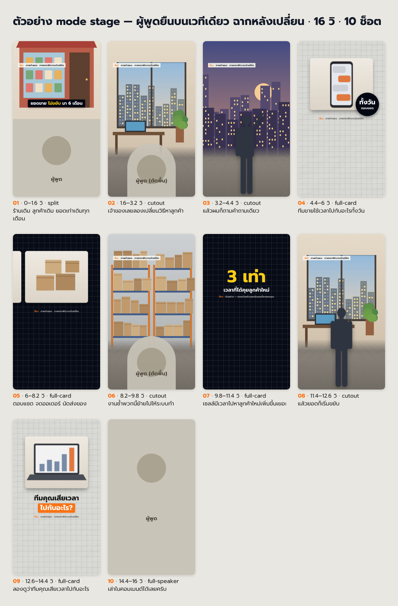

[← กลับหน้าแรก (README)](../README.md)

# 2 แบบภาพประกอบ: cutaway กับ stage

คลิปพูดหน้ากล้องที่ภาพนิ่งทั้งคลิป คนดูเลื่อนผ่านเร็ว tad-clip จึงใส่ภาพประกอบให้ได้ 2 แบบ
ทั้งสองแบบใช้คลิปเดิมของคุณ เสียงเดิม ซับเดิม ต่างกันแค่ว่าภาพรอบตัวคุณทำงานยังไง

| | cutaway (ค่าเริ่มต้น) | stage |
|---|---|---|
| หน้าตา | คุณพูดหน้ากล้อง แล้วตัดไปภาพจริง คลิปจริง มีม หรือการ์ดข้อความ แล้วกลับมาที่คุณ | คุณถูกตัดพื้นหลังออก ยืนบนพื้นเวทีแผ่นเดียวกันทุกฉาก ฉากหลังเปลี่ยนทุก 1–2 วินาที |
| ภาพเปลี่ยนบ่อยแค่ไหน | ทุก 2–4 วินาที | ทุก 1–2 วินาที |
| เหมาะกับ | คลิปส่วนใหญ่ เล่าเรื่องแบรนด์จริง อธิบายวิธีทำ มีหลักฐานให้โชว์ | เล่าเคสที่มีหลายสถานที่ หลายตัวละคร หรือมีตัวเลขไต่ขึ้นเรื่อยๆ |
| ต้องเตรียมเพิ่ม | ไม่ต้อง | รูปตัวเอง 2–4 ท่า (ไม่บังคับ) · รูปฉากหลังหลายภาพ |
| เครื่องที่ใช้ได้ | ทุกเครื่อง | Mac ใช้ได้เลย · Windows ต้องติดตั้งตัวตัดพื้นหลังเพิ่ม หรือใช้รูปนิ่งของตัวเองแทน |

ไม่บอกอะไร Claude ใช้ cutaway และบอกคุณหนึ่งบรรทัดว่าใช้แบบไหน
อยากได้ stage พิมพ์ตอนสั่งงานได้เลย เช่น `ตัดคลิป แบบ stage` หรือ `ใส่ภาพแบบยืนบนฉาก`

ภาพข้างบนคือ storyboard ของคลิปตัวอย่างที่แนบมากับชุดนี้ ภาพทั้งหมดวาดด้วยโค้ด และคนในช่องเวทีเป็นเงาคนตัวแทน ถ้าใช้คลิปจริง ช่องนั้นจะเป็นตัวคุณ

## cutaway: ตัดไปภาพแล้วกลับมาที่คุณ

แบบที่ชุดนี้ทำมาตั้งแต่รุ่นแรก ครึ่งบนของจอเปลี่ยนเป็นภาพจริงตามคำที่พูด ครึ่งล่างยังเห็นหน้าคุณ
คั่นด้วยการ์ดข้อความเต็มจอเป็นระยะ และมีมตรงประโยคที่ขำ

ใช้แบบนี้ถ้าคุณมีของจริงให้โชว์ เช่นหน้าจอระบบ แชตลูกค้า ภาพหน้างาน หรือเล่าเรื่องแบรนด์ที่มีโฆษณาและภาพเก่าให้หยิบมาใช้
วิธีเตรียมภาพอ่านต่อที่ [แทรกภาพ คลิป มีม เสียง](04-insert-materials.md)

## stage: คุณยืนบนเวที โลกด้านหลังเปลี่ยน

คุณยืนตำแหน่งเดิมตลอดคลิป พื้นใต้เท้าเป็นแผ่นเดียวกันทุกฉาก
พูดว่า "ร้าน" ฉากหลังเป็นร้าน พูดว่า "โกดัง" ฉากหลังเป็นโกดัง คนดูไม่ต้องหาคุณใหม่ทุกครั้งที่ภาพเปลี่ยน

ในคลิปแบบนี้มีภาพ 4 ชนิดสลับกัน

1. คุณบนเวที ฉากหลังเป็นสถานที่ที่กำลังเล่า
2. รูปนิ่งของคุณบนเวทีเดียวกัน ใช้ตอนอารมณ์เปลี่ยน เช่นตกใจหรือชี้ ราว 1 วินาที
3. การ์ดภาพมุมมนบนกระดาษกราฟ สีอ่อนหรือสีเข้ม แนะนำคนหรือของในเรื่อง หลายภาพจะเลื่อนไปทีละใบ ตัวเลขสำคัญขึ้นเป็นตัวใหญ่
4. แบ่งจอ ภาพบน คุณล่าง

ทุกรอยต่อมีเบลอแนวนอนสั้นๆ ราว 4 เฟรม ภาพจึงต่อกันลื่นแม้เปลี่ยนถี่

### เตรียมอะไรบ้าง

**รูปตัวเองสำหรับสลับท่า (ไม่บังคับ)** ถ่ายไว้ 2–4 ท่า ใช้ซ้ำได้ทุกคลิป

- ยืนหน้าผนังเรียบ แสงแบบเดียวกับตอนถ่ายคลิป ใส่เสื้อตัวเดียวกับในคลิป
- ท่าที่ใช้บ่อย: ยืนยิ้ม · ชี้ขึ้น · ตกใจหรือมือกุมหัว · ถือของ
- Claude ตัดพื้นหลังให้และครอปพอดีตัว ไม่ต้องลบพื้นเอง

ไม่มีรูปก็ทำได้ Claude ใช้ตัวคุณจากคลิปอย่างเดียว

**รูปทำงานจริง** ร้าน ทีม สินค้า หน้างาน ภาพพวกนี้ดีที่สุด เพราะเป็นหลักฐานด้วย

**ฉากที่ไม่มีรูป** มี 2 ทาง

- ให้ Claude หาภาพ stock ฟรีจาก Pexels, Pixabay หรือ Wikimedia Commons พร้อมจดเครดิต
- ให้ Claude เขียนคำสั่งทำภาพ (prompt) แล้วคุณเอาไปวางในเครื่องมือทำภาพที่ใช้อยู่ ตัวฟรีก็ได้ เซฟภาพกลับมาในโฟลเดอร์ที่ Claude บอก

ชุดนี้ไม่เรียก API ทำภาพเอง จึงไม่มีค่าใช้จ่ายเพิ่ม
ภาพ stock หรือภาพที่ทำขึ้นซึ่งยืนแทนเหตุการณ์จริง จะมีป้าย "ภาพจำลอง" บนจอทุกช็อต

### ข้อจำกัดที่ควรรู้ก่อนเลือก

- ถ้าคลิปถ่ายครึ่งตัว ใกล้กล้อง หรือถือไมค์ ตัดพื้นแล้วจะดูเหมือนยืนหลังเคาน์เตอร์ ไม่เห็นเต็มตัว อยากได้เต็มตัวต้องถ่ายให้ห่างกล้องราว 3 เมตร เห็นถึงเท้า
- รูปนิ่งปากไม่ขยับ จึงใช้ได้แค่จังหวะสั้น
- ซับย้ายตำแหน่งตามชนิดภาพ: ลอยเหนือหัวตอนอยู่บนเวที อยู่ใต้รอยต่อตอนแบ่งจอ และอยู่ที่เดิมบนการ์ด
- เรื่องที่ไม่มีของจริงให้โชว์ ภาพส่วนใหญ่จะเป็นภาพจำลอง ดูดีน้อยกว่าเรื่องที่มีรูปจริง
- Windows ที่ยังไม่ได้ติดตั้งตัวตัดพื้นหลัง ใช้ตัวคุณจากคลิปบนเวทีไม่ได้ ต้องใช้รูปนิ่งที่ตัดพื้นแล้ว หรือติดตั้งเพิ่มตาม[คู่มือ Windows](02-install-windows.md)

## เปลี่ยนแบบหลังทำไปแล้ว

บอก Claude ได้เลย เช่น `เปลี่ยนเป็นแบบ stage` Claude จะเขียน plan ใหม่และส่ง storyboard ให้ดูก่อนเรนเดอร์
plan เดิมยังอยู่ ถ้าอยากกลับไปใช้ cutaway บอกให้ใช้ plan เดิม

---

หน้าแนะนำ tad-clip: [punnattapatch.com/free/tad-clip](https://punnattapatch.com/free/tad-clip?utm_source=github&utm_medium=docs&utm_campaign=tad-clip) · kit นี้ทำโดย @pun_nattapatch

[← กลับหน้าแรก (README)](../README.md)
